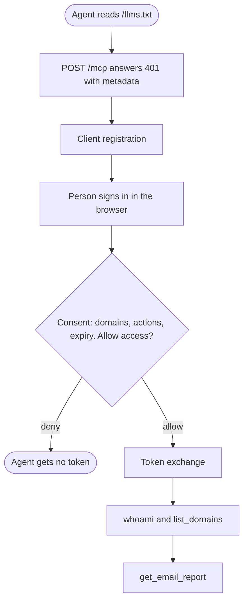

# An AI agent connects and reads its first report

- **Value moment:** The agent receives its first useful report (`get_email_report`).
- **Visitor:** an MCP client acting for a person who already has an account.
- **As built on `main` 6a7d775 (2026-11-15).** Consent needs an HTTPS issuer.

