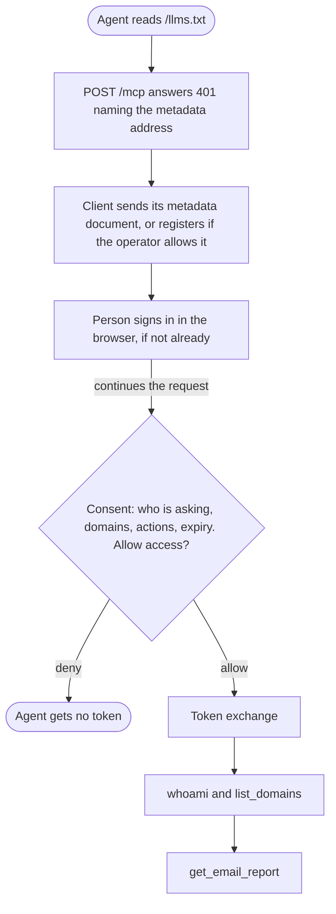

# An AI agent connects and reads its first report

- **Value moment:** The agent receives its first useful report (`get_email_report`).
- **Visitor:** an MCP client acting for a person who already has an account.
- **As built on `main` 61e6b8f plus the agents-connect change (2026-11-16).** Consent needs an HTTPS issuer. A client with a published client ID metadata document skips registration; registration is vetted, limited and expires after 24 hours unless approved, and the hosted service switches it on (`MCP_DCR_ENABLED=1`, ADR 0022). The consent page leads with who is verifiable (the publisher's host, or the address the app sends you back to) and shows the app's own name only as what it "calls itself"; its buttons stay at the bottom of the screen; signing in on the way carries the request through, so the person lands on the consent page, not the dashboard (`?continue=`, `web/src/lib/resume.ts`).

