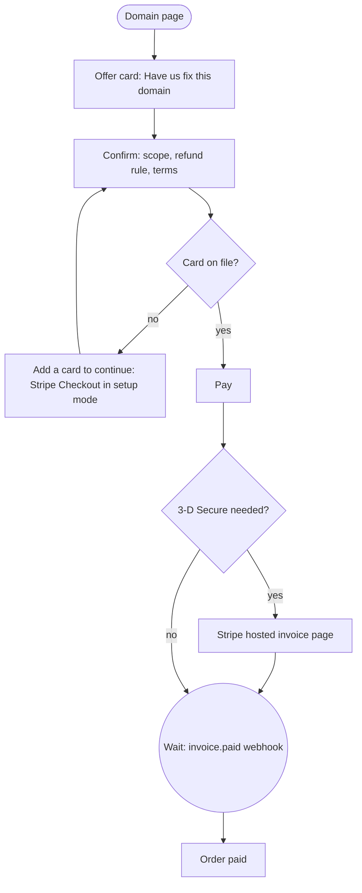

# Hosted owner buys Fix one domain in the app

- **Value moment:** Fix ordered: the invoice is paid (Stripe's `invoice.paid` webhook, or the daily reconcile if the webhook is lost).
- **Visitor:** the owner of a hosted workspace with billing on.
- **As built on `main` 6a7d775 (2026-11-15).** Billing is off in production (no Stripe secrets).

