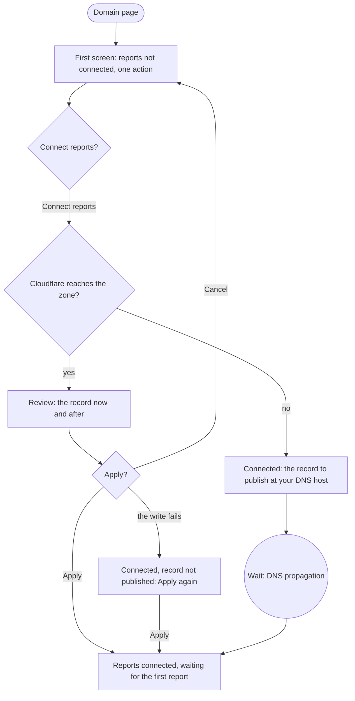

# A hosted owner connects a verified domain's reports through Cloudflare

- **Value moment:** Reports connected, waiting for the first report: the live DMARC record lists the shared report address and the domain is connected. Only for a workspace `HOSTED_CONNECT_REPORTS` admits (where it does not, the page says so and offers no action).
- **Visitor:** a hosted owner or admin whose domain is verified, DNS-managed through a Cloudflare connection, and has no Ready Set Mail report address (for example `p=reject` with no `rua=`).
- **As built on this change, on `main` 531bc57 + the change (2026-11-16).** Shortened from the value moment backwards: the statement and the action are one panel in the first screen, the review replaces a wizard the person had to find by typing its URL, and one Apply connects and writes.

## Friction

On `main` 531bc57 (measured 2026-11-16, local hosted instance, `HOSTED_CONNECT_REPORTS=all`, a verified domain linked to the Cloudflare fake, live record `v=DMARC1; p=reject;`):

- The domain page said "Reports not connected yet" 1.5 viewport heights down at 1440x900 (2.5 at 375x812; 338 words above it for the operator); the domain settings page said it with no action at all.
- Connecting only connected: the record to publish was then a copy-paste, and the one action that wrote it (wizard step 4, "Apply via Cloudflare") was reachable only by typing its URL for a domain at `p=reject`, because "Continue setup" is hidden there. Shortest sequence: 1 typed URL and 1 click; in the app alone: 5 clicks, 3 scrolls and a collapsed section.
- Step 5 of the wizard had no way back to step 4.

Now: Connect reports is in the first screen on both phones and desktops (bottom of the button at 0.70 / 0.52 of the viewport height for a member of the public, 0.83 / 0.64 for the operator, whose settings banner is one line), the review shows the record now and after, and the flow is two clicks and no typed URL.
