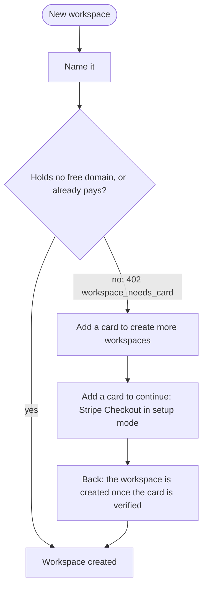

# Hosted owner creates a second workspace

- **Value moment:** the new workspace exists and the person is in it.
- **Visitor:** the owner of a hosted workspace with `HOSTED_PLAN=free_one_domain` who already holds their free domain.
- **As built in this pull request (server side; the screens are the next phase).**

