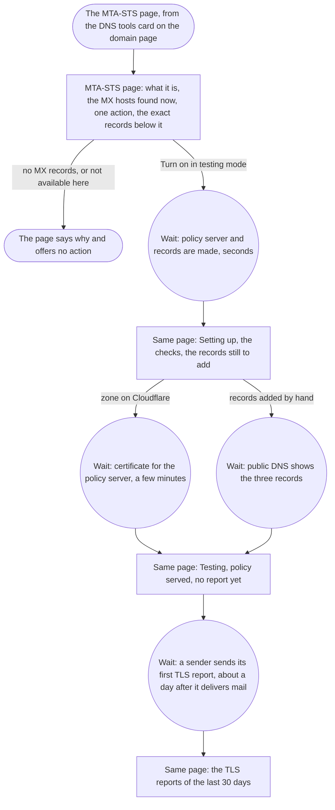

# A hosted owner turns on MTA-STS and sees TLS reports arrive

- **Value moment:** The policy is served in testing mode and the first TLS report from a sending mail server is on the page, with who sent it, for which days, how many sessions worked and how many failed.
- **Visitor:** an owner or admin of a hosted workspace with a proven domain. Their zone is on Cloudflare (the connection writes the records) or not (they add three records by hand).
- **As built by the MTA-STS pull request (2026-11-16), shortened from the value moment backwards.** Before it, `main` had a four-step wizard (MX discovery that previewed nothing, a mode choice, the three records, done) that on the hosted service answered "connect Cloudflare first" and never showed a single TLS report: four wizard screens and a card, one decision (the mode), value not reachable. The mode choice goes (testing is the only way in: RFC 8461 section 5, and the server refuses enforce without the reports), the MX preview and the records move onto the one screen that has the action, the action comes before the records so it is on the first screen of a phone (and, since round 2, the records Cloudflare writes sit behind "Show records" and the definitions of MX, CNAME and TXT are gone: about 330 words on the whole path, was 1,054), and the page that says "Setting up" is the page that later shows the reports, so nothing is re-explained. The states below share one address (`/#/domains/:id/mta-sts`): counted by address the flow is one page.
- **The door.** The flow starts on the MTA-STS page. The usual way in is the MTA-STS card under "DNS tools" on the domain page; that card sits at the bottom of the domain page and is below its first screen at both widths (measured with a hosted domain page on 2026-11-16: 0.58 viewport heights down at 1440, 1.42 at 375), so it is not on the walked path and its words are checked by `web/test/mta-sts.test.tsx` and `e2e/mta-sts.spec.ts`. Surfacing MTA-STS higher on the domain page is an owner decision, not made here.

## Measures of the map

Shortest path from the page to the value moment: four screens counted by state (page, setup, live, reports; one by address), no decisions, three waits that only time can shorten (the records, the certificate, the sender's report). The old wizard path had a card and four steps, one decision and no value moment. Nothing on the way is asked twice: the MX hosts are shown once, before the action, and the records only behind "Show records". Round 2 added no step: "served" is the result of a fetch of the policy address (Check now does that fetch; the server also repeats it when the page is opened and the last one is over 10 minutes old, and the page says when it was checked; Check now stays, small, while "served" is claimed), and Switch to enforce is the filled action from the moment the policy is served, so it is on the first screen at 375.

## Branches that are not the shortest path

- By hand: the page lists exactly the records still to add, with a copy control each, and the third (the one that tells senders a policy exists) only once the certificate is active.
- Enforce is not on this flow: it is offered later on the same page, disabled with the reasons until the reports show senders can use TLS; turning it off is also later and has its own rule (only in testing, and only once senders no longer hold an enforce policy).
