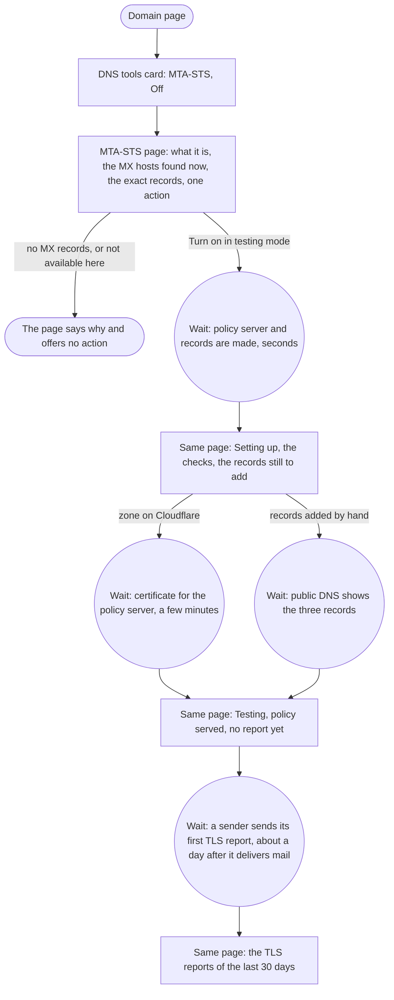

# A hosted owner turns on MTA-STS and sees TLS reports arrive

- **Value moment:** The policy is served in testing mode and the first TLS report from a sending mail server is on the page, with who sent it, for which days, how many sessions worked and how many failed.
- **Visitor:** an owner or admin of a hosted workspace with a proven domain, on the domain page. Their zone is on Cloudflare (the connection writes the records) or not (they add three records by hand).
- **As built by the MTA-STS pull request (2026-11-16), shortened from the value moment backwards.** Before it, `main` had a four-step wizard (MX discovery that previewed nothing, a mode choice, the three records, done) that on the hosted service answered "connect Cloudflare first" and never showed a single TLS report: six screens, one decision (the mode), value not reachable. The mode choice goes (testing is the only way in: RFC 8461 section 5, and the server refuses enforce without the reports), the MX preview and the exact records move onto the one screen that has the action, and the page that says "Setting up" is the page that later shows the reports, so nothing is re-explained. The states below share one address (`/#/domains/:id/mta-sts`); counted by address, the whole flow is two pages, the domain page and this one.

## Measures of the map

Shortest path from the domain page to the value moment: five screens counted by state (card, page, setup, live, reports; two by address), no decisions, three waits that only time can shorten (the records, the certificate, the sender's report). The old wizard path had six screens, one decision and no value moment. Nothing on the way is asked twice: the MX hosts and the records are shown once, before the action, and the same records are listed again only behind "The three records".

## Branches that are not the shortest path

- By hand: the page lists exactly the records still to add, with a copy control each, and the third (the one that tells senders a policy exists) only once the certificate is active.
- Enforce is not on this flow: it is offered later on the same page, disabled with the reasons until the reports show senders can use TLS; turning it off is also later and has its own rule (only in testing, and only once senders no longer hold an enforce policy).
