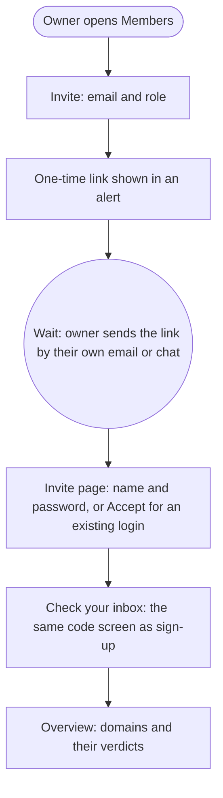

# Invited teammate joins the workspace

- **Value moment:** The teammate sees the workspace's domains with each one's verdict.
- **Visitor:** a teammate invited by an owner or admin; a read-only member by default (only an owner can invite an admin).
- **As built on `main` 6a7d775 (2026-11-15), then PR #177.** An ordinary invite sends no email: the owner passes the link on. A hand-off ("Hand setup to a teammate") emails a fixed invitation and lands the teammate on that domain's S4.

