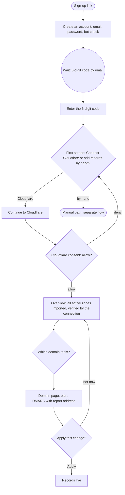

# New hosted user signs up and gets records live through Cloudflare

- **Value moment:** Records live: ownership proven and DMARC with the report address seen in public DNS.
- **Visitor:** a new hosted user who arrives at the sign-up link with a domain on Cloudflare.
- **As built on `main` 6a7d775 (2026-11-15).** PR #177 rebuilds sign-up; redraw and re-walk when it merges.

