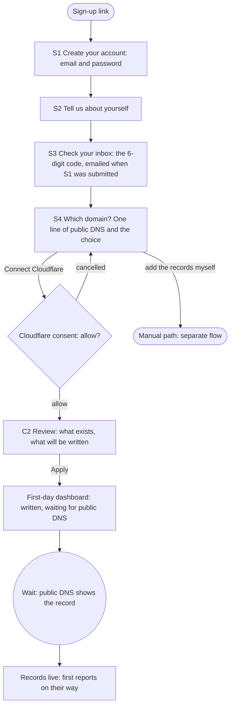

# New hosted user signs up and gets DMARC live through Cloudflare

- **Value moment:** Records live: ownership proven and DMARC seen in public DNS. The report address is in the record only for a workspace `HOSTED_CONNECT_REPORTS` admits (by default the operator's own); any other new customer gets DMARC without it.
- **Visitor:** a new hosted user who arrives at the sign-up link, with a domain on Cloudflare.
- **As built by PR #177 (2026-11-16).** S1 to S4, Cloudflare's own consent, C2 review and the first-day dashboard. An agency ("My clients'") has only the client domain's zone imported; a company has every active zone.

