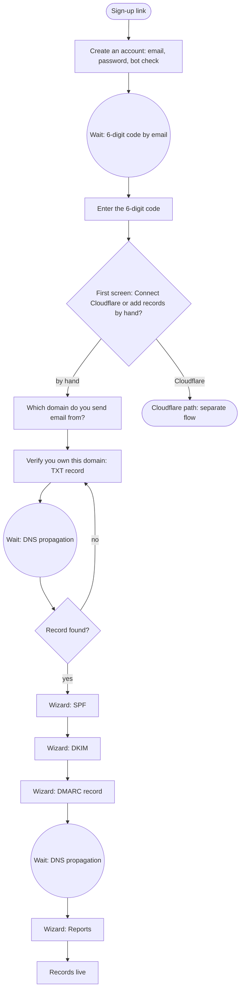

# New hosted user signs up and gets records live by hand

- **Value moment:** Records live: ownership proven by the TXT record and DMARC seen in public DNS. The report address is in the record only for a workspace `HOSTED_CONNECT_REPORTS` admits (by default the operator's own); any other new customer gets DMARC without it.
- **Visitor:** a new hosted user whose DNS is not on Cloudflare (or who prefers to paste records).
- **As built on `main` 6a7d775 (2026-11-15).** PR #177 rebuilds sign-up; redraw and re-walk when it merges.

