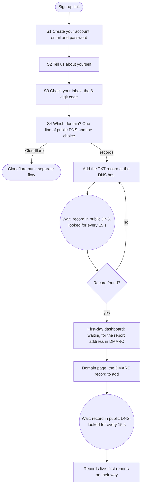

# New hosted user signs up and gets DMARC live by adding records by hand

- **Value moment:** Records live: ownership proven by the TXT record and DMARC seen in public DNS. The report address is in the record only for a workspace `HOSTED_CONNECT_REPORTS` admits (by default the operator's own); any other new customer gets DMARC without it.
- **Visitor:** a new hosted user whose DNS is not on Cloudflare (or who prefers to paste records).
- **As built by PR #177 (2026-11-16).** S1 to S4, then the record screen, which looks for the record every 15 seconds while open, and the first-day card, which looks for the DMARC record the same way.

