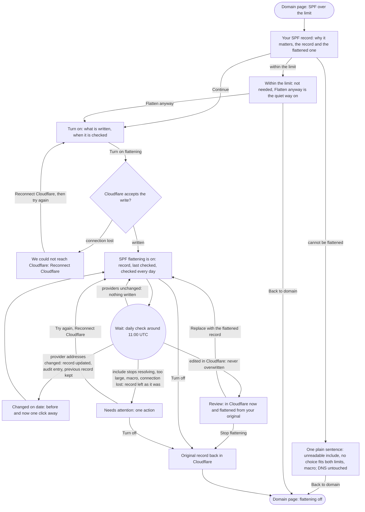

# Owner turns on SPF flattening and it stays correct

- **Value moment:** Flattening is on: the SPF record in Cloudflare lists the sender addresses directly, within 10 lookups and 450 bytes, and the daily check keeps it current, or says on the domain page why it could not and what to do. The owner can turn it off and get the original record back.
- **Visitor:** the owner or an admin of a domain whose SPF record needs more than 10 DNS lookups (RFC 7208 section 4.6.4), with Cloudflare connected, on a self-hosted instance or on a hosted workspace the operator enabled it for (`HOSTED_SPF_FLATTENING`). Everyone else on hosted sees nothing.
- **As built in this change (2026-11-16).** Basis: owner, Nov 16: "Spf is a continuous work. Its an add on and it needs its own price, per domain" (price open); ADR 0022 (one refresh engine), ADR 0023 (the add-on). Shortened from the value backwards (ADR 0012): the old Analyze and Compare screens are one, so the path is the card, one screen with both records, one screen with the write, and the state view.

## Failure paths: what the person sees, and the one action

| Path | Where it is found | What the person sees | The one action |
|---|---|---|---|
| Cloudflare connection lost | turning on, every daily check, turning off | "We could not reach Cloudflare. Your record in Cloudflare is unchanged." | Reconnect Cloudflare |
| A provider include stops resolving (no record, two records, SERVFAIL, truncated answer, loop) | the screen before turning on, turning on, the daily check | "We could not read the SPF record of X (why). Your record in Cloudflare is unchanged." | Try again |
| Nothing fits within 10 lookups and 450 bytes | the screen before turning on, turning on, the daily check | One sentence naming what the best choice would need; the record is left as it is | Back (before turning on); Turn off (when on) |
| A macro in an include or redirect target | same | "X uses a macro, so the addresses depend on who is sending and cannot be flattened." | Back; Turn off |
| Someone edits the record in the app by hand | `apply-spf` | "SPF flattening is on for this domain. Turn it off before editing the SPF record here." | Turn flattening off on the domain page |
| Someone edits the record in Cloudflare | every daily check, before any write | "...not the one Ready Set Mail published, so someone changed it there. We have left it as it is." | Review |
| The record is deleted in Cloudflare | same | "There is no SPF record at X in Cloudflare now. We have not added one." | Review |
| Turning off and Cloudflare refuses the original back | turning off | The original record is shown to copy; the row is kept | Try again |
| Turning off over an outside edit | turning off | "We left it as it is": flattening stops, nothing is written over the edit | none |
| The add-on is switched off for a hosted workspace that has it on | every screen | "Flattening is not switched on for this workspace any more, so the record is no longer refreshed." | Turn off |
| The daily check does not run | the last check is older than two days | "Last checked X. The daily check has not run since." | none (the operator's job) |
